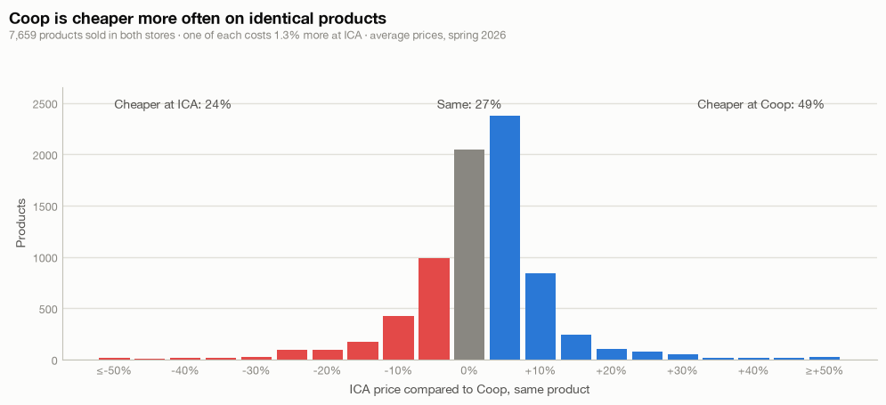
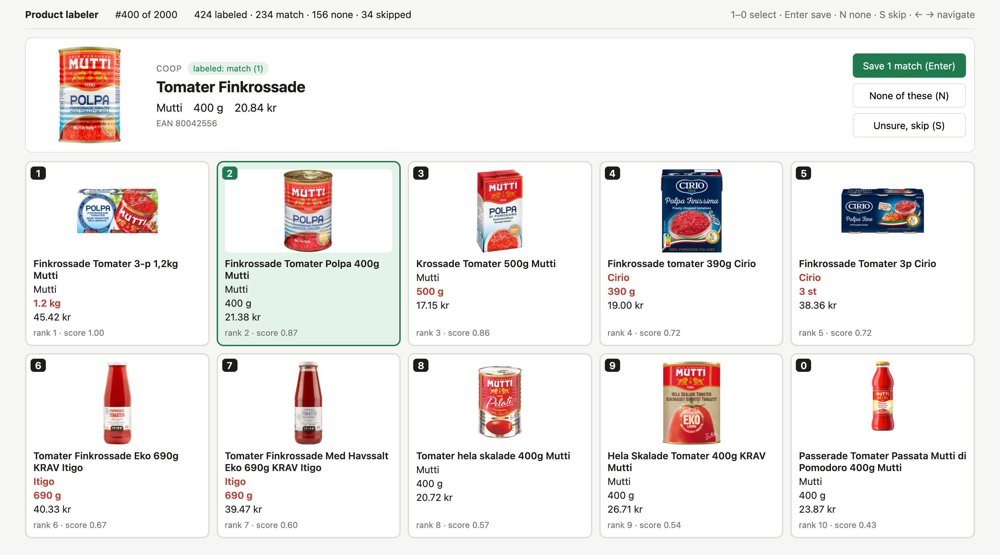
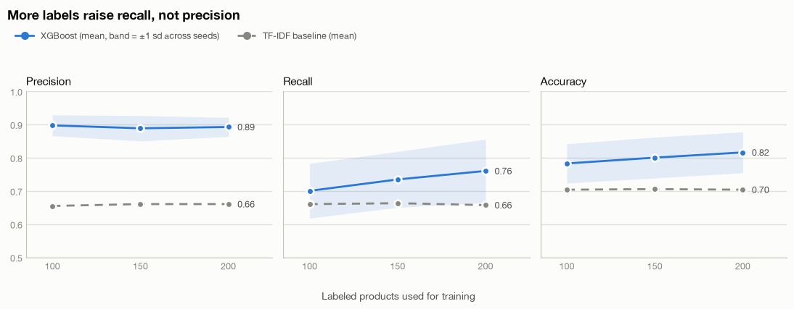

# product-matcher

**Is ICA or Coop cheaper?** To answer that fairly you have to compare the *same* product in both stores. ICA's
product data has no barcodes, so there's no key to join on. This project matches identical products across two of
Sweden's largest grocery chains with a small ML pipeline, then uses the matches to compare prices.

The product and price data comes from my web scraper project,
[matjakt-scraper](https://github.com/adam-ostberg/matjakt-scraper), which collects listings from both stores' online shops.



**Result:** across 7,659 identical products, Coop is cheaper on 49%, ICA on 24%, and 27% cost the same (±2.5%).
The median product costs 2.4% more at ICA. One of each product costs 1.3% more at ICA in total. The picture
differs by brand: Nelson Garden seeds and bulbs, for example, are cheaper at ICA 89% of the time.

## The problem

- **No shared key.** Coop products are keyed by EAN, ICA products by an internal UUID. Matching has to rely on names,
  brands, pack sizes and prices.
- **"Identical" is strict.** Same brand *and* same pack size. A 400 g can of Mutti tomatoes isn't a match for a
  3-pack or a 500 g carton of the same tomatoes. Private labels (ICA, Coop, Änglamark, ...) can't have a match and are excluded.
- **The two stores describe products differently.** ICA usually puts brand and size in the name
  (`Finkrossade Tomater Polpa 400g Mutti`), Coop usually doesn't (`Tomater Finkrossade`). Units and brand
  spellings vary (`0,5L` vs `50cl`, `Eget Bageri` vs `egetbageri`).
- **No labels.** Without barcodes there's no ground truth, so I built a labeling tool and labeled 424 products by hand.

## Pipeline

```
download_data.py    Postgres -> parquet snapshots (57,016 ICA and 32,602 Coop products)
explore.ipynb       normalize, parse pack sizes, exclude private labels -> 10 ICA candidates per Coop product (TF-IDF)
labeler/            React tool: pick the identical product among the 10 candidates, or "none"
train.ipynb         pair features + XGBoost, cross-validated by product, logged to experiments.csv
results.ipynb       learning curve: does more labeling help?
match.ipynb         score the held-out test set once, match every product, compare prices
```

1. **Normalization.** Lowercasing, accent and punctuation cleanup, brand normalization with aliases. A pack-size
   parser turns `6x33cl`, `0,5L` and `Läsk 33cl 10-p` into a value in g / ml / st. Brand and size are stripped from
   names so both stores' names look alike.
2. **Candidate generation.** TF-IDF on character 2–4-grams of brand + name, cosine similarity in chunks, top 10 ICA
   products for each of the 26,814 eligible Coop products. Size is left out on purpose, so the same product in another
   size shows up as a hard negative.
3. **Labeling.** A small React + Vite app with keyboard shortcuts. Labels are appended to `labels/labels.jsonl`
   through an API inside the Vite dev server. Products are labeled in random order so the labels are a random sample.

   
   *Rank 1 is the 1.2 kg 3-pack. The identical 400 g can is rank 2, so the model has to learn more than "take the top hit".*

4. **Model.** One row per (Coop product, ICA candidate) with 10 features: TF-IDF score, rank, gap to the best
   candidate, brand equality and similarity, name similarity and Jaccard overlap, same unit, size ratio and price ratio.
   XGBoost scores each pair. Per Coop product, the best candidate is the match if it clears a threshold, otherwise "no match".
5. **Evaluation.** 5-fold cross-validation grouped by Coop product, so all candidates of a product stay in the same
   fold. Scoring is per product: a prediction is correct if it picks the right ICA product, or correctly says there is none.
   123 products (orders 301–423 in `labels/split.json`) were held out and scored once, at the end.

## Results

Held-out test set: 109 products (123 minus 14 skipped as unsure). The threshold is 0.8, chosen on the dev set to aim
for about 90% precision, because a wrong match adds a fake price difference to the comparison.

| Test set | Precision | Recall | Accuracy |
|---|---|---|---|
| TF-IDF score + tuned threshold (baseline) | 0.635 | 0.746 | 0.725 |
| **XGBoost** | **0.889** (95% CI 0.79–0.98) | 0.635 | 0.771 |

Cross-validated on the 281 dev products at threshold 0.5, XGBoost reaches 0.884 precision and 0.760 recall,
against 0.667 / 0.702 for the baseline. `experiments.csv` logs every run.

Matching all 26,814 Coop products gives 8,089 matches (about 7,200 expected correct). 7,659 remain after dropping
weighed goods, unknown pack sizes and price gaps over 3x.



More labels raised recall but not precision. The two most important features are the gap to the best candidate
and the size ratio.

## Limitations

- **Recall is capped by candidate generation.** If the identical product isn't in the TF-IDF top 10, the model can't find it.
- **The test set is small.** With 109 products the precision interval is wide (0.79–0.98).
- **One snapshot per store** (spring 2026). ICA prices are averaged across stores, since each ICA store sets its own prices.
- **The price comparison only covers matched products.** That leaves out private labels and fresh goods sold by weight,
  where a lot of the real price competition happens.

## Running it

The raw data lives in the Postgres database that [matjakt-scraper](https://github.com/adam-ostberg/matjakt-scraper)
writes to. It isn't included here, since the scraped listings are the stores data and not mine to redistribute,
so the notebooks can't be re-run as-is.
They're committed with their outputs, so everything above can be read on GitHub. `labels/` holds the hand-made labels.

```bash
python -m venv .venv && source .venv/bin/activate
pip install -r requirements.txt

# DATABASE_URL=postgresql://... in .env
python download_data.py --tables public.products coop.products
```

Then run `notebooks/explore.ipynb`, label in `labeler/` (`pnpm install && pnpm dev`, then open http://localhost:5173),
and run `train.ipynb`, `results.ipynb` and `match.ipynb`.

## Stack

Python, pandas, scikit-learn, XGBoost, matplotlib, Jupyter · React, Vite · PostgreSQL
